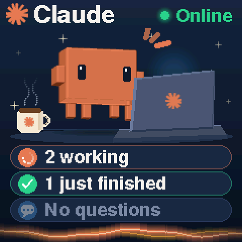

# Agentur

*Agent + ur* (Norwegian for clock). A cheap yellow wifi clock ("Smart Weather Clock", ESP-12F/ESP8266,
240×240 ST7789 display) with custom firmware that shows what your Claude Code sessions are up to:
how many are working, how many are waiting for an answer from you, and how many just finished.
A small pixel mascot sits at a laptop and changes mood with the state.




## How it fits together

```
Claude Code hooks ──► hooks/agentur-status.sh ──HTTP GET /state──► the clock (10.42.0.2)
  (prompt, tool use,    combines the state of          on an isolated hotspot
   stop, questions)     all open sessions              on the PC
```

- **`hooks/agentur-status.sh`** runs from Claude Code hooks. Each session writes its state to
  `~/.cache/agentur/sessions/`, the script combines them (question > working > done > idle) and
  sends the result to the clock in the background. It never blocks the session; errors are ignored.
  The hook configuration is in `hooks/settings-example.json`.
- **`firmware/`** is the firmware (PlatformIO). The clock only joins the hotspot, never opens
  outgoing connections (no NTP, cloud or telemetry), and requires a password for updates and pin
  configuration. If it can't find the hotspot, it starts its own recovery network.
- **`firmware/src/scene.h`** draws the screen. It depends only on Adafruit GFX, so the exact same
  code runs in the simulator on the PC.
- **`firmware/sim/`** holds the simulators and the tools that build the mascot sprites from a 3D model.

## Getting started

You need [PlatformIO](https://platformio.org/), `g++`, `python3`, `jq` and `curl`.

1. **Secrets:** copy `firmware/include/secrets.example.h` to `secrets.h` and fill it in.
2. **Hotspot:** set up a wifi hotspot on the PC with the same name and password. With
   NetworkManager the PC gets `10.42.0.1`, and the clock uses the fixed IP `10.42.0.2`. The clock
   also answers to `agentur.local` (mDNS).
3. **First flash** goes over serial (`pio run -t upload` in `firmware/`). After that, new firmware
   can be uploaded over wifi at `http://10.42.0.2/update` (user `agentur`, the hotspot password).
4. **Hook:** copy `hooks/agentur-status.sh` to `~/.claude/hooks/` and add the hooks from
   `hooks/settings-example.json` to `~/.claude/settings.json`.

### Simulator

The web simulator runs `scene.h` on the PC and shows the screen in the browser. It uses Adafruit GFX
from `.pio/libdeps`, so run `pio pkg install` in `firmware/` first.

```bash
firmware/sim/web/start.sh 8791
```

Open `http://localhost:8791`.

`firmware/sim/sim.cpp` is a command-line variant that writes a still and animation frames for every
state, and checks that partial redraws give exactly the same image as a full redraw.

## The clock's HTTP endpoints

| Endpoint | What |
|---|---|
| `/` | list of endpoints |
| `/info` | status as JSON |
| `/state?s=working&w=2&q=1&v=1&n=<ms>` | set state (`idle`, `working`, `question`, `done`) and counters (working, needs an answer, recently finished); `n` is a timestamp so late messages are dropped |
| `/bright?v=0..255` | brightness |
| `/cfg?dc=&rst=&bl=&blinv=&mode=&rot=&inv=` | display pins and setup, requires the password |
| `/update` | upload new firmware, requires the password |

The display pins on these clocks aren't documented. The defaults (DC=GPIO0, RST=GPIO2,
backlight=GPIO5 inverted, SPI 13/14) are what has been reported for the ESP-12F version, but
everything can be changed via `/cfg` without new firmware.

## Note

Unofficial hobby project, not made by or affiliated with Anthropic. The Claude logo and the
mascot belong to Anthropic.
